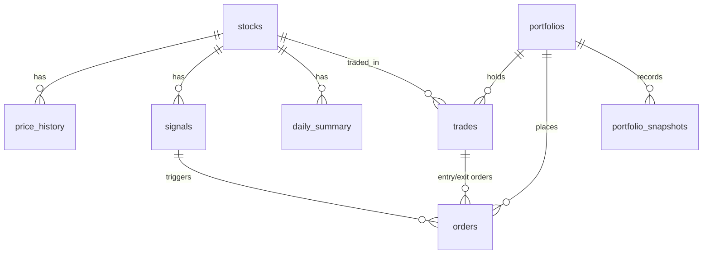

# Database Schema

Defined in [`database/models.py`](../database/models.py). Migrations live in
[`database/migrations/versions/`](../database/migrations/versions/) (Alembic, `0001_initial_schema.py`).

* All timestamps are **naive UTC**. Convert to the market time zone (`Asia/Bangkok`, `America/New_York`) only for display.
* Enums are stored as `VARCHAR` + `CHECK` constraints, so the schema is identical on SQLite and PostgreSQL.
* Prices are `FLOAT` (fine for research; use `NUMERIC` if you need exact accounting).



## Tables

| Table | Purpose | Key columns |
|---|---|---|
| `stocks` | master list of instruments | `symbol` (unique), `name`, `market` (TH/US/CRYPTO), `exchange`, `sector`, `currency`, `is_active`, `added_at` |
| `price_history` | OHLCV bars **with up/down change** | `stock_id`, `interval` (1m/5m/1h/1d), `timestamp`, `open/high/low/close`, `adj_close`, `volume`, `prev_close`, `change`, `percent_change`, `direction` (`UP`/`DOWN`/`UNCHANGED`), `source`. Unique on (`stock_id`,`interval`,`timestamp`) |
| `signals` | every strategy decision | `stock_id`, `strategy`, `signal_type` (BUY/SELL/HOLD), `interval`, `timestamp` (bar time), `price`, `reason`, `indicators` (JSON), `acted_on`, `action_note`. Unique per bar → re-runs never double-trade |
| `orders` | every order sent (paper or live) | `side`, `order_type` (MARKET/LIMIT), `quantity`, `limit_price`, `reference_price`, `status` (PENDING/FILLED/CANCELLED/REJECTED/EXPIRED), `filled_price`, `commission`, `slippage`, `broker`, `broker_order_id`, `purpose` (ENTRY/SIGNAL/STOP_LOSS/TAKE_PROFIT), `message`, `trade_id`, `signal_id` |
| `trades` | round-trip positions; `status=OPEN` rows **are** the current positions | `strategy_used`, `mode` (PAPER/LIVE), `status`, `quantity`, `entry_price/time`, `exit_price/time`, `stop_loss`, `take_profit`, `entry/exit_commission`, `pnl` (net), `pnl_pct`, `exit_reason` |
| `portfolios` | current account state | `name` (unique), `mode`, `currency`, `initial_capital`, `cash`, `positions_value`, `equity`, `peak_equity`, `realized_pnl` |
| `portfolio_snapshots` | equity curve (one row per cycle) → daily/monthly PnL, drawdown | `timestamp`, `cash`, `positions_value`, `equity`, `drawdown_pct`, `open_positions`, `positions` (JSON) |
| `daily_summary` | per-stock daily up/down summary | `date` (market-local), `prev_close`, `open/high/low/close`, `volume`, `change`, `percent_change`, `direction`, `intraday_range_pct`, `last_signal`. Unique on (`stock_id`,`date`) |
| `backtest_runs` | saved backtests | `symbol`, `strategy`, `params` (JSON), `interval`, `start`, `end`, `initial_capital`, `final_equity`, `metrics` (JSON), `trades` (JSON) |
| `alert_logs` | every alert sent | `alert_type`, `level`, `title`, `message`, `channels`, `delivered`, `error` |

## How % change is calculated

```
change         = close - prev_close           (prev_close = previous bar of the same interval)
percent_change = change / prev_close * 100
direction      = UP if percent_change > 0, DOWN if < 0, else UNCHANGED
```

After every insert/update the change columns are **recomputed from the earliest touched bar onward**, so
back-filling older history never leaves stale values.

## Migrations

```bash
alembic upgrade head                      # create / upgrade (URL from config's database.url)
STOCK_BOT_CONFIG=config/config.yaml alembic upgrade head
alembic revision --autogenerate -m "add column"   # after changing models.py
alembic downgrade -1
alembic upgrade head --sql                # print SQL instead of running it
```

`python main.py init-db` uses `create_all()` for a quick start; use Alembic once you have data you care about.

## Useful queries

```sql
-- Biggest daily gainers/losers for a date
SELECT s.symbol, d.close, d.percent_change, d.direction
FROM daily_summary d JOIN stocks s ON s.id = d.stock_id
WHERE d.date = '2026-10-30' ORDER BY d.percent_change DESC;

-- Count of up vs down days per stock
SELECT s.symbol, p.direction, COUNT(*) FROM price_history p JOIN stocks s ON s.id = p.stock_id
WHERE p.interval = '1d' GROUP BY s.symbol, p.direction;

-- Closed trades by strategy
SELECT strategy_used, COUNT(*), SUM(pnl), AVG(CASE WHEN pnl > 0 THEN 1.0 ELSE 0 END) AS win_rate
FROM trades WHERE status = 'CLOSED' GROUP BY strategy_used;
```
